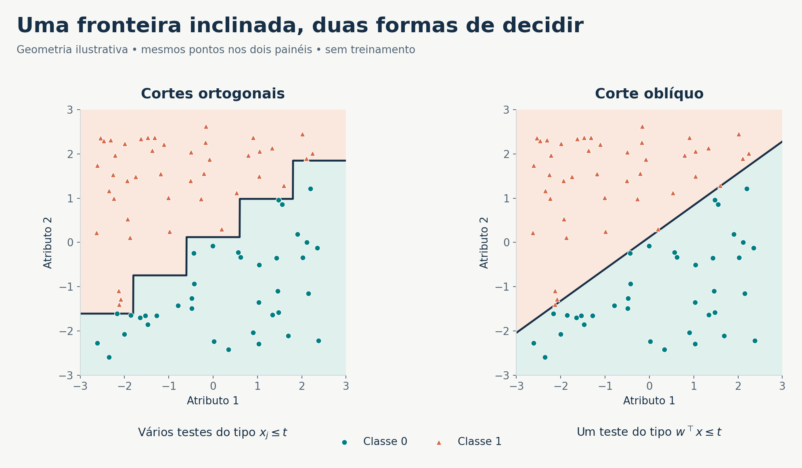
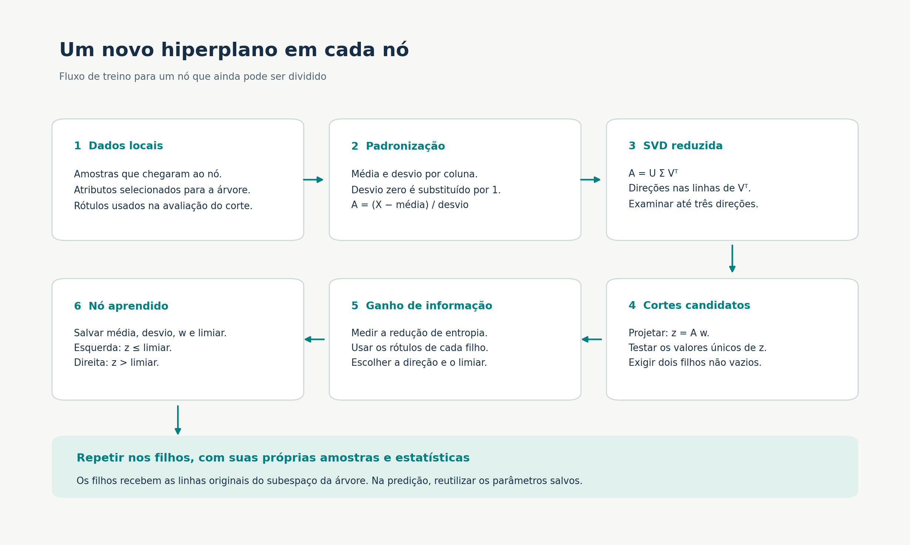
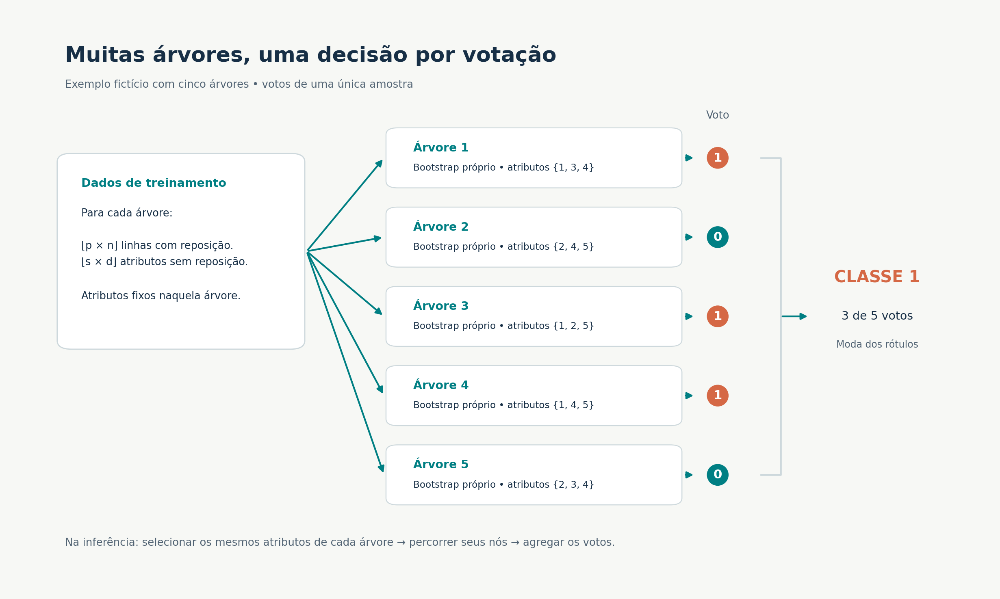

# Kaggle-oRF — Floresta de Decisão Oblíqua

Implementação acadêmica de **Oblique Random Forest (oRF)** para o Trabalho Prático 1 de **PCS 3838 — Inteligência Artificial**, da Escola Politécnica da Universidade de São Paulo. O projeto constrói árvores que combinam várias características em cada decisão, reúne essas árvores em uma floresta e gera um arquivo de predições para a competição Kaggle da disciplina.

A implementação inclui uma árvore ortogonal, uma árvore oblíqua, suas respectivas florestas e um gerador de CSV. Na árvore oblíqua, as direções candidatas são obtidas por **PCA via decomposição em valores singulares (SVD), recalculada em cada nó**, e escolhidas com seus limiares pelo **ganho de informação baseado em entropia**.

> **Estado do projeto:** o código está implementado e há uma demonstração com dados sintéticos. Os dados oficiais, o endereço da competição, as pontuações no Kaggle e um relatório preenchido não foram fornecidos. O material em `docs/relatorio/template/` é um modelo de relatório, com campos de exemplo. As figuras abaixo são didáticas e não representam resultados da competição.

## Guia de leitura

| Quero entender… | Documento |
|---|---|
| O problema, as restrições e o que deve ser entregue | [Enunciado e critérios de entrega](docs/enunciado/README.md) |
| A matemática de árvores, PCA, entropia e votação | [Fundamentos teóricos](docs/teoria/README.md) |
| As classes, os métodos e os detalhes da implementação | [Documentação de `src/`](src/README.md) |
| Como instalar, executar e reproduzir um treino | [Guia de execução](docs/execucao/README.md) |
| Como comparar acurácia e custo computacional | [Guia de experimentos](docs/experimentos/README.md) |
| Como preparar os dados e o CSV da competição | [Guia do Kaggle](docs/kaggle/README.md) |
| Como organizar e compilar o relatório de duas páginas | [Guia do relatório](docs/relatorio/README.md) |

O [índice da documentação](docs/README.md) sugere percursos de leitura e distingue o que já existe do que ainda depende dos dados oficiais.

## 1. O desafio proposto

O trabalho pede a implementação de uma floresta formada por árvores de decisão oblíquas. Em uma árvore convencional, cada nó testa uma única característica. Em uma árvore oblíqua, o nó testa uma combinação linear de características, permitindo fronteiras inclinadas no espaço dos dados.

Há uma restrição central: **cada nó deve definir seu próprio hiperplano**. Transformar todo o conjunto uma única vez e treinar uma árvore ortogonal sobre os dados transformados não atende ao enunciado. Neste código, cada chamada recursiva calcula média, desvio padrão e SVD usando somente as amostras que chegaram ao nó.

Além de implementar o algoritmo, o trabalho pede:

1. Uma submissão no Kaggle utilizando a oRF implementada.
2. Uma comparação com uma floresta ortogonal, considerando desempenho preditivo e custo de treinamento e/ou predição.
3. Um relatório de **no máximo duas páginas**, no modelo fornecido pela disciplina.
4. A implementação da oRF em **um único arquivo `.py`**. Aqui, as classes do modelo estão reunidas em [`src/oRF.py`](src/oRF.py); [`src/GeradorCSV.py`](src/GeradorCSV.py) é um utilitário separado para a submissão.

É permitido usar bibliotecas para operações como PCA/SVD e cálculo de projeções. A floresta oblíqua deve ser implementada pelo aluno; o enunciado não permite entregar uma implementação pronta de oRF. Veja a [matriz de requisitos](docs/enunciado/README.md) e as imagens originais do enunciado.

## 2. Da árvore ortogonal à árvore oblíqua

Considere uma amostra com características $x\in\mathbb{R}^d$. Um nó ortogonal escolhe um atributo $j$ e um limiar $t$:

$$
x_j\leq t\Rightarrow\text{filho esquerdo},\qquad x_j>t\Rightarrow\text{filho direito}.
$$

Um nó oblíquo escolhe um vetor de pesos $w$ e um limiar:

$$
w^\top x\leq t\Rightarrow\text{filho esquerdo},\qquad w^\top x>t\Rightarrow\text{filho direito}.
$$

Em duas dimensões, a fronteira é uma reta; em três, um plano; em dimensões maiores, um hiperplano. O vetor $w$ é normal à fronteira. Uma árvore inteira combina vários testes para formar regiões de decisão.



**Como ler a figura:** os mesmos pontos aparecem nos dois painéis. As linhas ilustram regras geométricas escolhidas para o exemplo; não são modelos treinados nem uma comparação empírica. Árvores oblíquas podem representar certas fronteiras com menos nós, mas isso não garante maior acurácia em qualquer conjunto de dados.

## 3. Como o nó oblíquo é aprendido

No código, a regra oblíqua é aplicada sobre características padronizadas **localmente**. Para os dados $X_v$ de um nó $v$, calcula-se:

$$
\widetilde{X}_v=(X_v-\mu_v)\oslash\sigma_v,
\qquad
\widetilde{X}_v=U\Sigma V^\top.
$$

$\oslash$ representa divisão por coluna. Desvios iguais a zero são substituídos por 1. As linhas de `Vt`, retornado pela SVD, fornecem as direções principais. O algoritmo examina até **três** dessas direções e projeta as amostras:

$$
z_i=\left((x_i-\mu_v)\oslash\sigma_v\right)^\top w.
$$

Para cada direção, os valores distintos de $z$ são candidatos a limiar. Apenas partições com dois filhos não vazios são consideradas. O par direção–limiar com maior ganho de informação é armazenado no nó, junto com a média e o desvio padrão.



Os filhos recebem as linhas originais do subconjunto de atributos da árvore e ajustam suas próprias transformações. Durante a predição, cada nó reutiliza seus parâmetros de treino; **não se recalcula PCA usando o conjunto de teste**.

### Entropia e ganho de informação

Se $p_c$ é a proporção da classe $c$ no nó, sua impureza é:

$$
H(Y)=-\sum_c p_c\log_2 p_c.
$$

Uma separação em filhos esquerdo $L$ e direito $R$ recebe o ganho:

$$
IG=H(Y)-\frac{n_L}{n}H(Y_L)-\frac{n_R}{n}H(Y_R).
$$

Um nó com quatro exemplos de cada uma de duas classes tem entropia de 1 bit. Se o corte produz filhos com proporções 3:1 e 1:3, a entropia ponderada cai para aproximadamente 0,8113 bit e o ganho é 0,1887 bit. Uma separação perfeita teria ganho de 1 bit.

**PCA e supervisão têm papéis diferentes:** a SVD propõe direções a partir das características, sem consultar os rótulos. O ganho de informação usa os rótulos para escolher a melhor direção e o melhor limiar entre os candidatos. O [guia de teoria](docs/teoria/README.md) apresenta a derivação, a equivalência do hiperplano nas coordenadas originais e exemplos numéricos.

## 4. Da árvore à floresta

Para cada uma das $k$ árvores, o código sorteia:

- $\lfloor pn\rfloor$ linhas **com reposição**: uma amostra bootstrap, na qual uma mesma observação pode aparecer várias vezes;
- $\lfloor sd\rfloor$ atributos **sem reposição**, escolhidos uma vez para toda aquela árvore.

Cada árvore é treinada com seu subconjunto. Na predição, ela recebe os mesmos atributos, na mesma ordem. A floresta retorna a classe mais votada:

$$
\widehat{y}(x)=\operatorname{mode}\big(h_1(x_{F_1}),\ldots,h_k(x_{F_k})\big).
$$



Esta implementação combina bagging com subespaços aleatórios **por árvore**. Isso difere da seleção de atributos por nó usada em formulações usuais de Random Forest. A diversidade das árvores busca reduzir a dependência de uma única amostra ou de um único conjunto de atributos.

### Parâmetros e critérios atuais

| Componente | Valores padrão | Interpretação |
|---|---|---|
| `DecisionTreeClassifier` | `max_depth=100` | Árvore ortogonal |
| `ObliqueDecisionTreeClassifier` | `max_depth=10` | Árvore com PCA/SVD local |
| `RF` | `k=10, p=0.6, s=0.1` | Floresta ortogonal |
| `oRF` | `k=250, p=0.63, s=0.27` | Floresta oblíqua |

As árvores também param quando o nó é puro, tem menos de dez amostras ou não existe uma separação válida. A folha retorna a classe majoritária. Não há poda nem exigência explícita de ganho mínimo positivo. As florestas instanciam suas árvores com a profundidade padrão; não recebem `max_depth` em seus construtores.

**Uma comparação entre os padrões de `RF()` e `oRF()` muda simultaneamente o número de árvores, a amostragem, os atributos e a profundidade.** O [guia experimental](docs/experimentos/README.md) explica como registrar e controlar essas diferenças.

## 5. Execução rápida

Execute os comandos a partir da raiz do repositório. O ambiente usado para verificar a documentação foi Python 3.12, com as versões de dependências listadas em [`requirements.txt`](requirements.txt).

```bash
git clone https://github.com/luigiscofano/Kaggle-oRF.git
cd Kaggle-oRF
python -m venv .venv
source .venv/bin/activate
python -m pip install -r requirements.txt
python src/oRF.py
```

No PowerShell, substitua a ativação por `.\.venv\Scripts\Activate.ps1`. O programa cria 100 amostras sintéticas com dez atributos, separa treino e teste, treina a oRF e imprime `Accuracy: ...`. Essa saída é uma demonstração local, **não uma pontuação do Kaggle**. O gerador de dados e a divisão têm semente fixa; a floresta usa o gerador global do NumPy, portanto o resultado pode variar entre execuções.

Um [exemplo com semente explícita](docs/execucao/exemplo_minimo.py) pode ser executado com:

```bash
python docs/execucao/exemplo_minimo.py
```

Não são necessários arquivos da competição para esses dois exemplos. Mais detalhes, contrato de entrada e solução de problemas estão no [guia de execução](docs/execucao/README.md).

## 6. Gerando a submissão para o Kaggle

Obtenha os dados na competição indicada pela disciplina e disponibilize `data/data.npz` com as chaves `X_train`, `y_train` e `X_test`. A URL da competição não é recuperável a partir das imagens recebidas do enunciado e não foi presumida nesta documentação.

```bash
python -c "from pathlib import Path; Path('data').mkdir(exist_ok=True); Path('submissions').mkdir(exist_ok=True)"
python docs/kaggle/validar_dados.py
python src/GeradorCSV.py
```

O gerador treina `oRF()` em todos os dados rotulados e grava `submissions/submission.csv`, com colunas `ID` e `Prediction`. Os IDs são sequenciais, de 1 até o número de amostras de teste. **Confira essa convenção no arquivo de exemplo da competição antes de enviar.** O script sobrescreve um CSV anterior no mesmo caminho.

O [guia do Kaggle](docs/kaggle/README.md) explica formatos, validação local, prevenção de vazamento de dados e conferência da submissão. As pastas `data/` e `submissions/` já são ignoradas pelo Git.

## 7. Organização do repositório

| Caminho | Conteúdo |
|---|---|
| [`src/oRF.py`](src/oRF.py) | Modelos, nós, critérios de divisão e demonstração sintética |
| [`src/GeradorCSV.py`](src/GeradorCSV.py) | Treinamento com o arquivo NPZ e exportação da submissão |
| [`src/README.md`](src/README.md) | Referência da implementação |
| [`docs/`](docs/README.md) | Guias do enunciado, teoria, execução, experimentos, Kaggle e relatório |
| [`docs/imagens/`](docs/imagens/README.md) | Três figuras explicativas e seu script de geração |
| [`docs/relatorio/template/`](docs/relatorio/template/README.md) | Fontes e PDF do modelo enviado, preservados como material de referência |
| [`requirements.txt`](requirements.txt) | Dependências do projeto nas versões verificadas |

## 8. Limitações e próximos experimentos

A busca por limiares percorre valores distintos e separa amostras em laços Python. Em bases maiores, esse custo pode ser significativo. O código não oferece paralelismo, estimativa out-of-bag, probabilidades, persistência de modelos ou tratamento automático de valores ausentes. As entradas devem ser numéricas, finitas e ter dimensões coerentes.

A escolha das primeiras direções de PCA privilegia variância, que não é necessariamente a informação mais útil para separar classes. O máximo de três direções também limita a busca. Na configuração padrão, poucos atributos podem resultar em zero colunas selecionadas: é necessário garantir `int(s * d) >= 1`.

Para evoluir o projeto, há espaço para medir a relação entre acurácia e tempo, testar diferentes números de árvores e atributos, investigar outras propostas de hiperplanos por nó e otimizar a busca por limiares. Essas possibilidades são **trabalhos futuros**, não funcionalidades já implementadas.

## 9. Referências

A documentação parte do código deste repositório e do [enunciado fornecido](docs/enunciado/README.md). As referências acadêmicas sugeridas no trabalho e a documentação oficial das bibliotecas estão reunidas no [guia de teoria](docs/teoria/README.md#referencias). Elas contextualizam o tema; seus resultados não são apresentados como resultados desta implementação.
