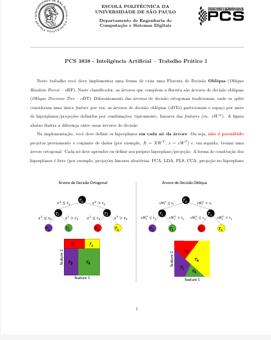
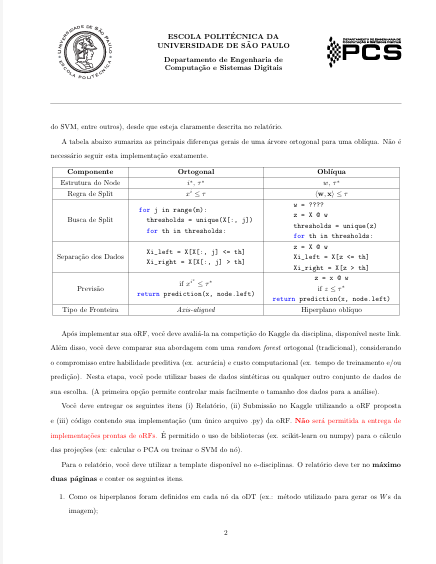
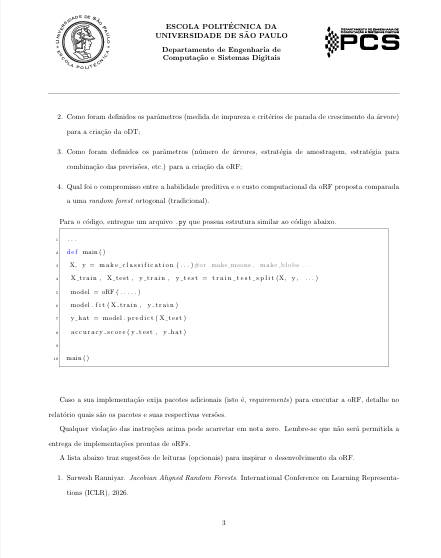
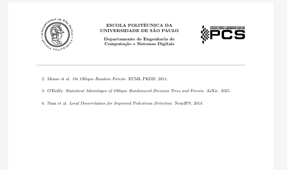

# Enunciado e requisitos do trabalho

[Projeto](../../README.md) · [Documentação](../README.md)

**Disciplina:** PCS 3838 — Inteligência Artificial. **Atividade:** Trabalho Prático 1. **Instituição:** Escola Politécnica da Universidade de São Paulo, Departamento de Engenharia de Computação e Sistemas Digitais.

Esta página organiza as quatro imagens do enunciado enviadas com o projeto. É uma síntese para orientar implementação e entrega, acompanhada das páginas originais ao final.

## Objetivo

Implementar uma **Floresta de Decisão Oblíqua (oRF)**, formada por árvores cujos nós usam combinações lineares de características. Avaliar o modelo na competição Kaggle da disciplina e estudar seu compromisso entre habilidade preditiva e custo computacional, comparando-o a uma floresta ortogonal tradicional.

O trabalho permite escolher a forma de construir os hiperplanos: projeções aleatórias, PCA, LDA, PLS, CCA, projeções relacionadas a SVM ou outras alternativas, desde que o método seja explicado. O requisito essencial é que o hiperplano seja definido **em cada nó**. Uma transformação única de todos os dados seguida por uma árvore ortogonal não atende a essa exigência.

## Requisitos e localização no projeto

| Exigência do enunciado | Como se relaciona ao repositório | Situação |
|---|---|---|
| Implementar a oRF, sem entregar modelo pronto de biblioteca | Classes `ObliqueDecisionTreeClassifier` e `oRF` em [`src/oRF.py`](../../src/oRF.py) | Implementado |
| Construir hiperplanos em cada nó | `get_best_split` recalcula padronização e SVD para os dados locais | Implementado |
| Explicar como são obtidos os pesos do hiperplano | Até três direções de SVD, avaliadas com ganho de informação | Documentado em [teoria](../teoria/README.md) |
| Explicar impureza e critérios de parada | Entropia, profundidade, pureza, tamanho mínimo para tentar dividir e existência de corte válido | Documentado em [`src/`](../../src/README.md) |
| Explicar número de árvores, amostragem e combinação | `k`, `p`, `s`, bootstrap, atributos por árvore e moda | Documentado no [README principal](../../README.md) |
| Avaliar acurácia e custo em comparação com RF | `RF` existe; há um [roteiro experimental](../experimentos/README.md) | Estudo completo pendente |
| Fazer submissão no Kaggle usando a oRF | [`GeradorCSV.py`](../../src/GeradorCSV.py) produz o CSV | Depende dos dados e das regras oficiais |
| Entregar implementação em um único `.py` | `src/oRF.py` contém os modelos e um `main()` demonstrativo | Arquivo disponível; conferir forma final de entrega |
| Entregar relatório com no máximo duas páginas | [Modelo e guia](../relatorio/README.md) | Modelo disponível, relatório não preenchido |
| Informar pacotes adicionais e como obter dados | Dependências e contrato de dados documentados | Transpor as informações relevantes ao relatório final |

Uma marcação “implementado” indica correspondência entre o código e o requisito descrito; não equivale a validação ou nota da disciplina.

## Entregáveis

1. **Relatório:** usar o modelo da disciplina e respeitar o limite de duas páginas. Explicar o método dos hiperplanos, os critérios da árvore, a configuração da floresta e o compromisso entre desempenho e custo frente à RF.
2. **Submissão Kaggle:** produzir predições com a oRF proposta, no formato exigido pela competição.
3. **Código:** entregar um único `.py` contendo a implementação da oRF. Bibliotecas podem apoiar o cálculo de projeções, mas não substituir a implementação da floresta por uma oRF pronta.

Para a comparação de custo e qualidade, o enunciado permite bases sintéticas ou outros conjuntos de dados. Dados sintéticos facilitam variar tamanho da amostra e número de atributos. O exemplo de código do enunciado segue o fluxo geração de dados → separação treino/teste → `fit` → `predict` → acurácia.

## Informações ainda necessárias para a competição

As imagens não permitem recuperar o destino do hiperlink “neste link”. Também não informam, de forma utilizável, identificador da competição, prazo, nomes dos arquivos oficiais ou métrica exata de pontuação. Esses itens devem ser consultados no ambiente da disciplina e na página da competição. A coluna `Prediction` e os IDs iniciando em 1 são convenções do **gerador atual**, a serem conferidas contra o exemplo oficial de submissão.

## Páginas originais

Clique nas imagens para consultar os arquivos em tamanho original.

### Página 1 — proposta e restrição de projeção por nó

### Página 2 — comparação entre árvores e entregáveis

### Página 3 — conteúdo do relatório e exemplo de implementação

### Página 4 — leituras sugeridas

