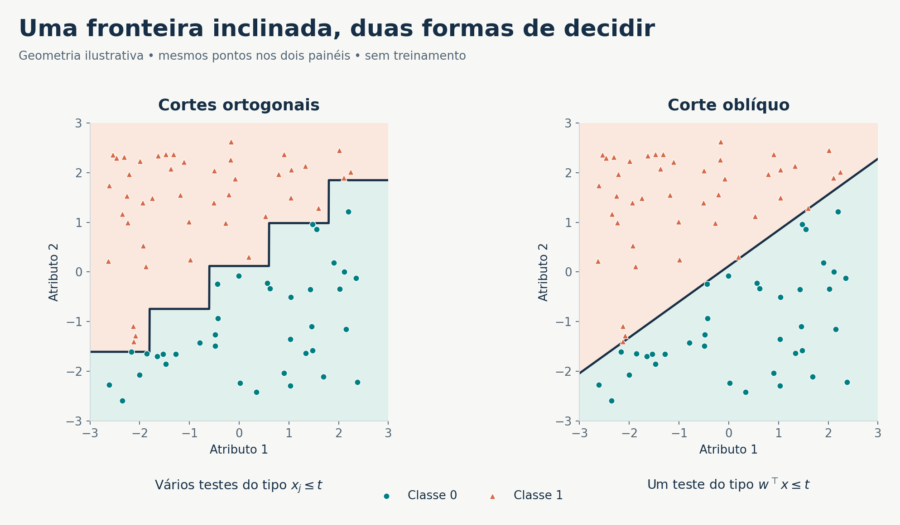
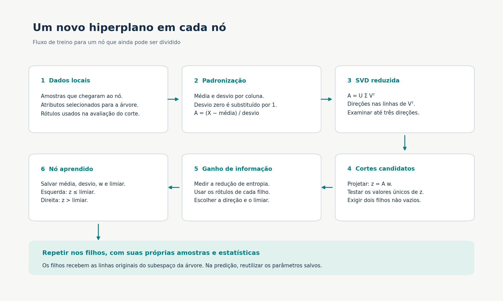
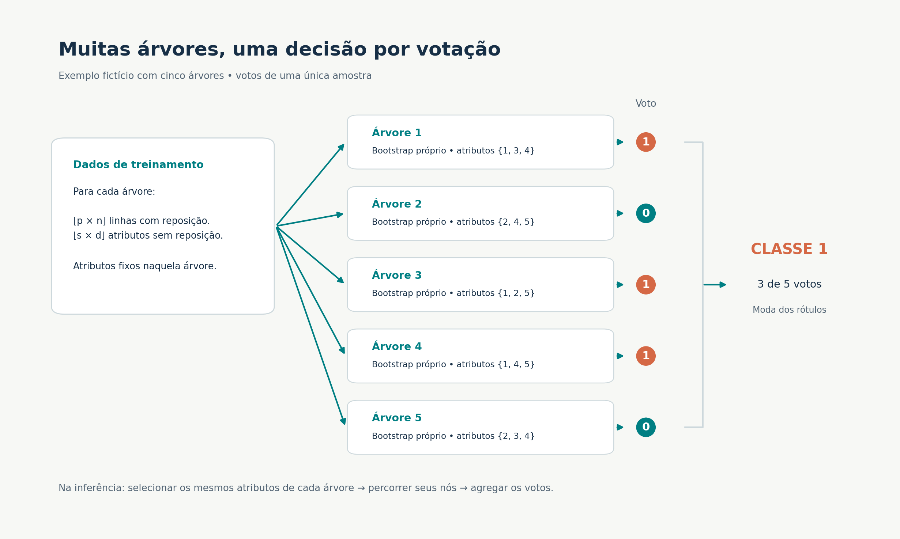

# Fundamentos matemáticos da oRF

[Projeto](../../README.md) · [Documentação](../README.md) · [Implementação](../../src/README.md)

## 1. Problema de classificação

Considere um conjunto de treino $\mathcal{D}=\{(x_i,y_i)\}_{i=1}^n$, com $x_i\in\mathbb{R}^d$ e rótulos $y_i\in\{c_1,\ldots,c_C\}$. A matriz $X\in\mathbb{R}^{n\times d}$ contém uma observação por linha. O objetivo é aprender uma função que prediga a classe de novas observações.

Neste projeto, os rótulos usados nas florestas devem ser numéricos, pois a votação usa `scipy.stats.mode`. Os números identificam classes: não significam que exista uma distância ou ordem útil entre elas.

| Símbolo | Significado |
|---|---|
| $n$, $d$, $C$ | Número de amostras, atributos e classes |
| $v$, $X_v$, $Y_v$ | Nó e dados que chegaram a ele |
| $n_v$, $q$ | Número de amostras no nó e atributos disponíveis na árvore |
| $w$, $t$ | Direção de projeção e limiar do nó |
| $\mu_v$, $\sigma_v$ | Média e desvio por atributo no nó |
| $k$, $p$, $s$ | Número de árvores, fator de amostragem de linhas e fração de atributos |
| $F_b$ | Índices ordenados dos atributos da árvore $b$ |

## 2. Árvores e geometria dos cortes

Uma árvore de decisão divide recursivamente o espaço das características. Cada nó interno aplica uma regra binária; cada folha associa uma região do espaço a uma classe. A predição percorre as regras desde a raiz até uma folha.

O corte ortogonal usa $x_j\leq t$. Sua fronteira $x_j=t$ é paralela aos demais eixos. O corte oblíquo usa $w^\top x\leq t$, cuja fronteira é o hiperplano $w^\top x=t$. A normal é $w$; não se deve confundir esse vetor com uma direção ao longo da reta de separação.

Uma sequência de cortes ortogonais pode aproximar uma fronteira inclinada por degraus. Um corte oblíquo pode representá-la diretamente. Isso explica uma possível vantagem de representação, mas não estabelece superioridade estatística: amostras finitas, ruído, seleção de direções e complexidade do modelo também afetam a generalização.

## 3. Padronização local

Antes de propor os hiperplanos de um nó, o código calcula, para cada atributo $j$:

$$
\mu_{vj}=\frac{1}{n_v}\sum_{i=1}^{n_v}x_{ij},\qquad
\sigma_{vj}=\sqrt{\frac{1}{n_v}\sum_{i=1}^{n_v}(x_{ij}-\mu_{vj})^2}.
$$

O denominador é $n_v$, correspondente ao padrão `ddof=0` de `np.std`. Quando $\sigma_{vj}=0$, o código substitui esse valor por 1. Assim, uma coluna constante torna-se uma coluna de zeros após a centralização, sem divisão por zero.

$$
A_{ij}=\frac{x_{ij}-\mu_{vj}}{\sigma_{vj}}.
$$

A padronização coloca as colunas em escalas comparáveis antes da SVD. Todos esses parâmetros são calculados **apenas com as amostras de treino do nó**, incluindo repetições da amostragem bootstrap. Não são estatísticas do conjunto completo nem do conjunto de teste.

## 4. PCA por SVD

A chamada `np.linalg.svd(A, full_matrices=False)` decompõe:

$$
A=U\Sigma V^\top.
$$

Se $r=\min(n_v,q)$, a decomposição reduzida tem $U\in\mathbb{R}^{n_v\times r}$, $\Sigma\in\mathbb{R}^{r\times r}$ e $V^\top\in\mathbb{R}^{r\times q}$. A biblioteca retorna o vetor dos valores singulares em `S`, em vez de uma matriz diagonal materializada.

As linhas de `Vt` são vetores singulares direitos e correspondem a direções principais no espaço dos atributos. Para $n_v>1$:

$$
\frac{A^\top A}{n_v-1}
=V\frac{\Sigma^2}{n_v-1}V^\top.
$$

Logo, as direções são autovetores da matriz de covariância de $A$, e as variâncias associadas são proporcionais ao quadrado dos valores singulares. Não é necessário formar explicitamente a matriz de covariância para obtê-las. Veja a [documentação oficial da SVD](https://numpy.org/doc/stable/reference/generated/numpy.linalg.svd.html).

O código examina os vetores `Vt[0]`, `Vt[1]` e `Vt[2]`, quando existem. Formalmente, o número de candidatos é $r_c=\min(3,n_v,q)$. O comentário que menciona cinco componentes não corresponde ao limite executado no laço.

Para cada direção $w_j$, calcula-se $z=A w_j$. A SVD utiliza somente $X_v$; as classes entram depois, na avaliação dos cortes. Não há um objetivo supervisionado de PCA, LDA ou SVM nesta implementação.

Uma direção de alta variância pode não distinguir as classes. Se a informação discriminativa estiver fora das primeiras três direções examinadas, a busca poderá ignorá-la. Direções de variância nula também podem existir em dados de posto reduzido; não há filtragem explícita por valor singular, mas projeções constantes não geram divisões válidas.

## 5. Entropia e escolha do limiar

No nó $v$, seja $p_c=n_{vc}/n_v$. A entropia mede a mistura de classes:

$$
H(Y_v)=-\sum_{c:p_c>0}p_c\log_2 p_c.
$$

Um nó puro tem entropia zero. Para duas classes igualmente frequentes, a entropia é 1 bit. O código calcula as frequências com `np.unique` e utiliza [`scipy.stats.entropy`](https://docs.scipy.org/doc/scipy/reference/generated/scipy.stats.entropy.html), com `base=2`.

Para uma projeção $z$, os limiares candidatos são os próprios valores distintos observados: `np.unique(z)`. Não são os pontos médios entre valores consecutivos. O filho esquerdo recebe $z_i\leq t$ e o direito recebe $z_i>t$. O limiar máximo, por exemplo, deixa o filho direito vazio e é descartado.

$$
IG(w,t)=H(Y_v)-\frac{n_L}{n_v}H(Y_L)-\frac{n_R}{n_v}H(Y_R),
\qquad
(w^*,t^*)=\arg\max_{(w,t)\in\mathcal{C}_v}IG(w,t).
$$

$\mathcal{C}_v$ contém os pares de direção e limiar que geram filhos não vazios. Essa maximização percorre um conjunto limitado de candidatos; não busca todos os hiperplanos possíveis de $\mathbb{R}^q$.

### Exemplo de ganho de informação

| Grupo | Classe 0 | Classe 1 | Entropia |
|---|---:|---:|---:|
| Pai | 4 | 4 | 1,000000 bit |
| Filho esquerdo | 3 | 1 | 0,811278 bit |
| Filho direito | 1 | 3 | 0,811278 bit |

Como os dois filhos têm quatro amostras, $IG=1-(4/8)(0{,}811278)-(4/8)(0{,}811278)=0{,}188722$ bit. Se os filhos fossem puros, ambas as entropias seriam zero e o ganho seria 1 bit.

O melhor ganho começa em menos infinito. O código aceita ganho zero caso esse seja o melhor corte válido e não exige uma redução mínima de impureza. Em empates numéricos exatos, mantém o primeiro candidato encontrado, porque só atualiza a escolha com `>`.

## 6. Hiperplano nas coordenadas originais

A decisão armazenada pelo nó é:

$$
\sum_{j=1}^{q}w_j\frac{x_j-\mu_{vj}}{\sigma_{vj}}\leq t.
$$

Definindo $a_j=w_j/\sigma_{vj}$ e $b=t+a^\top\mu_v$, obtém-se:

$$
a^\top x\leq b.
$$

Portanto, padronizar localmente não impede que o teste seja um hiperplano no espaço original. No espaço completo de $d$ atributos, basta atribuir peso zero às colunas ausentes do subconjunto $F_b$ da árvore.

### Exemplo de uma predição

Considere $\mu=(2,4)$, $\sigma=(2,1)$, $w=(1,1)/\sqrt{2}$ e $t=1$. Para a amostra $x=(4,5)$:

$$
\widetilde{x}=(1,1),\qquad z=\widetilde{x}^\top w=\sqrt{2}>1.
$$

A amostra segue para a direita. Nas coordenadas originais, $a\approx(0{,}353553,0{,}707107)$ e $b\approx4{,}535534$. Como $a^\top x\approx4{,}949747>b$, a decisão é a mesma.

## 7. Recursão e folhas

Depois de escolher o corte, os filhos recebem as linhas de $X_v$ que pertencem a cada partição, ainda nas coordenadas de entrada da árvore. Cada filho calcula sua própria média, desvio e SVD. Essa estrutura atende à exigência de aprender hiperplanos por nó.

A recursão termina se o nó é puro, se a profundidade máxima foi atingida, se há menos de dez amostras ou se não existe corte válido. A raiz tem profundidade zero. A condição de dez amostras é um limite para **tentar dividir o nó**, não um mínimo de dez amostras em cada folha: um corte pode produzir uma folha com uma única observação.

A folha armazena a classe majoritária. O uso de `np.unique` ordenado seguido de `argmax` faz com que, em empate, a menor classe ordenada seja escolhida. Na predição, os parâmetros armazenados são usados sem refazer o treinamento.

## 8. Bagging, atributos e voto

Cada árvore $b$ recebe $n_b=\lfloor pn\rfloor$ sorteios de índices com reposição e $q=\lfloor sd\rfloor$ índices de atributos sem reposição. $n_b$ é o número de sorteios, não o número de observações distintas. A probabilidade de uma observação específica não ser sorteada é $(1-1/n)^{n_b}$; para amostras grandes, aproxima-se de $e^{-p}$. Essa relação descreve a amostragem, mas o código **não calcula uma métrica out-of-bag**.

O subconjunto $F_b$ é fixo ao longo da árvore. Os hiperplanos mudam por nó dentro desse subespaço. As árvores produzem rótulos, e a floresta retorna a moda dos votos. Na versão de SciPy verificada, o empate entre rótulos numéricos resulta no menor rótulo; não há desempate por confiança.

Mais árvores podem estabilizar a votação, mas aumentam tempo e memória. A amostragem diversifica os modelos; árvores muito semelhantes limitam o benefício da agregação. O balanceamento entre qualidade individual e dependência entre árvores é parte da motivação clássica das florestas aleatórias.

## 9. Custo computacional e limites da análise

Em um nó com $n_v$ amostras e $q$ atributos, uma SVD densa reduzida tem custo da ordem de $O(n_v q\min(n_v,q))$. Há até três direções e até $n_v$ limiares por direção. O código percorre as amostras novamente para cada limiar, produzindo até $O(r_c n_v^2)$ visitas às observações, além das cópias de linhas e do cálculo de frequências/entropia. Esses termos adicionais dependem de $q$ e da implementação de `np.unique`; a expressão não é um limite completo de todo o treinamento.

A árvore ortogonal também faz uma busca explícita sobre atributos, limiares e amostras. Na inferência, um teste ortogonal consulta uma coluna; um teste oblíquo padroniza e combina $q$ valores. Para profundidade $h$, o percurso de uma árvore oblíqua custa aproximadamente $O(hq)$ por amostra. A floresta repete o percurso nas $k$ árvores.

O custo total de treino depende do número de nós e da distribuição das amostras entre eles. Para avaliar o projeto, meça tempos reais com o [protocolo experimental](../experimentos/README.md), em vez de inferir velocidade apenas da notação assintótica.

## Referencias

As leituras abaixo contextualizam o tema. Seus algoritmos e hipóteses não são automaticamente os mesmos desta implementação.

1. **Breiman, L. — Random Forests (2001).** Referência de base para agregação de árvores e aleatoriedade. [Artigo do autor](https://www.stat.berkeley.edu/users/breiman/randomforest2001.pdf).
2. **Menze et al. — On Oblique Random Forests (2011).** Discute florestas com testes oblíquos; não deve ser descrito como uma implementação idêntica à PCA local deste projeto. [Artigo](https://people.csail.mit.edu/menze/papers/menze_11_oblique.pdf).
3. **Sarwesh Rauniyar — Jacobian Aligned Random Forests (ICLR 2026).** Leitura sugerida no enunciado. Seu precondicionamento linear global é uma abordagem distinta; adotá-lo isoladamente não substitui a exigência de hiperplanos por nó deste trabalho. [Publicação](https://proceedings.iclr.cc/paper_files/paper/2026/hash/a88763eb23936ced0c81603b9300c8d7-Abstract-Conference.html).
4. **Eliza O'Reilly — Statistical Advantages of Oblique Randomized Decision Trees and Forests.** Estudo teórico de modelos aleatórios oblíquos; não constitui garantia de desempenho da oRF com PCA em qualquer classificação. [arXiv:2407.02458](https://arxiv.org/abs/2407.02458). O registro começou em 2024; o enunciado menciona 2025. Consulte a versão usada ao preparar a referência final.
5. **Woonhyun Nam, Piotr Dollár e Joon Hee Han — Local Decorrelation for Improved Pedestrian Detection (NeurIPS 2014).** Explora representação de atributos e custo em detecção de pedestres. “Local” nesse artigo não deve ser equiparado automaticamente a “recalcular PCA em cada nó”. [Publicação](https://proceedings.neurips.cc/paper_files/paper/2014/hash/cb14ff88f6287b2c11a1ec3fcf931855-Abstract.html).
6. **NumPy:** [`numpy.linalg.svd`](https://numpy.org/doc/stable/reference/generated/numpy.linalg.svd.html).
7. **SciPy:** [`scipy.stats.entropy`](https://docs.scipy.org/doc/scipy/reference/generated/scipy.stats.entropy.html) e [`scipy.stats.mode`](https://docs.scipy.org/doc/scipy/reference/generated/scipy.stats.mode.html).

As equações e os exemplos didáticos desta página explicam as operações observadas em [`src/oRF.py`](../../src/oRF.py). As figuras são produzidas pelo [script de ilustrações](../imagens/gerar_figuras.py).
